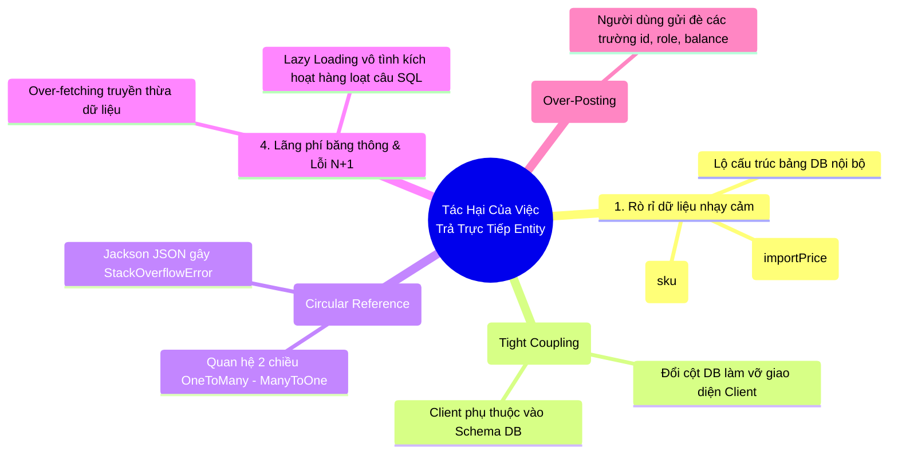
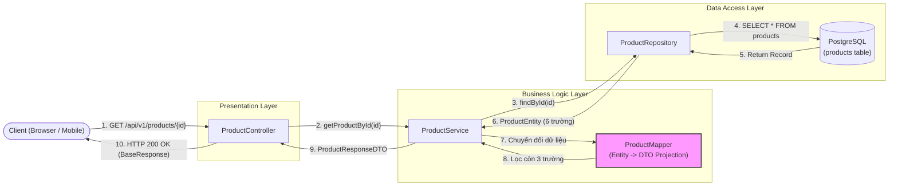
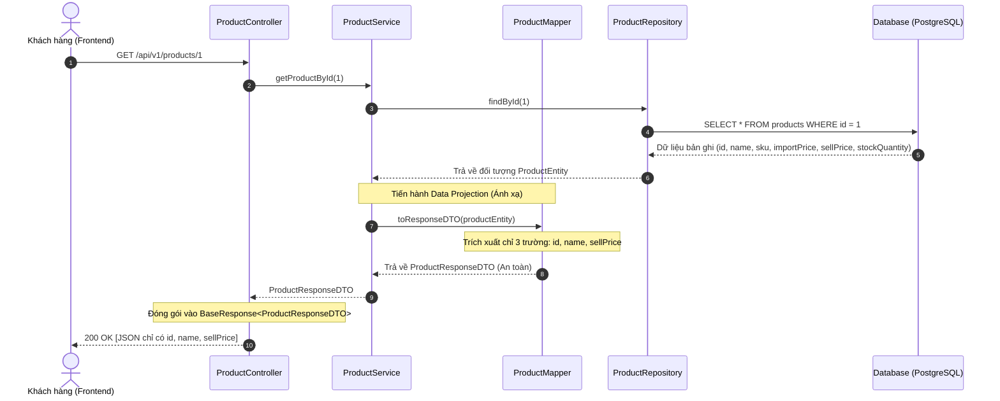

# TÀI LIỆU THIẾT KẾ: THIẾT KẾ DTO VÀ RESPONSE CHUẨN HÓA
## Chủ đề: Data Transfer Object (DTO) Pattern & Bảo Mật Dữ Liệu Sản Phẩm
**Hệ thống**: E-Commerce Microservices (`product-service`)  
**Bài học áp dụng**: Lesson 03 - DTO & Data Projection  

---

## 1. MỤC TIÊU & BỐI CẢNH NGHIỆP VỤ

### 1.1. Bối cảnh bài toán
Trong hệ thống Thương mại điện tử (E-commerce), bảng cơ sở dữ liệu `products` lưu trữ đầy đủ các thông tin nội bộ của sản phẩm để phục vụ quản lý kho, nhập hàng và kế toán. Các trường dữ liệu này bao gồm:
- **`importPrice` (Giá nhập hàng)**: Giá gốc doanh nghiệp nhập từ nhà cung cấp.
- **`sku` (Mã quản trị kho / Stock Keeping Unit)**: Định danh vị trí và quy ước lưu kho nội bộ.
- **`stockQuantity` (Số lượng tồn kho)**: Dữ liệu nhạy cảm về năng lực cung ứng của doanh nghiệp.

Khi cung cấp API tra cứu thông tin sản phẩm cho người tiêu dùng (Khách hàng cuối / Frontend Website):
- Khách hàng chỉ có nhu cầu biết: Mã hiển thị (`id`), Tên sản phẩm (`name`) và Giá bán niêm yết (`sellPrice`).
- Nếu trả trực tiếp `ProductEntity` về phía Client, toàn bộ thông tin giá nhập, kho vận sẽ bị phơi bày trên môi trường mạng.

### 1.2. Mục tiêu kỹ thuật
1. **Bảo mật dữ liệu (Data Encapsulation & Security)**: Giấu kín tuyệt đối thông tin nhạy cảm (`importPrice`, `sku`, `stockQuantity`).
2. **Triển khai DTO Pattern**: Xây dựng lớp bọc dữ liệu `ProductResponseDTO` chỉ chứa 3 trường cần thiết: `id`, `name`, `sellPrice`.
3. **Phân tách trách nhiệm (Separation of Concerns)**: Áp dụng cơ chế Mapping giữa Entity và DTO tại tầng Service, Controller tiếp nhận và trả về DTO chuẩn hóa.

---

## 2. TẠI SAO TUYỆT ĐỐI KHÔNG TRẢ VỀ ENTITY TRỰC TIẾP? (LESSON 03)

Việc trả trực tiếp ORM Entity ra ngoài API là một **Anti-Pattern (Lỗi thiết kế nghiêm trọng)** trong phát triển phần mềm vì 5 nguyên nhân cốt lõi sau:



### Chi tiết 5 rủi ro:
1. **Lộ bí mật kinh doanh & Dữ liệu nhạy cảm (Information Disclosure)**:
   - Khi trả về Entity, giá nhập (`importPrice`) sẽ hiển thị trong JSON payload. Đối thủ hoặc khách hàng chỉ cần mở DevTools (F12) là biết được biên lợi nhuận của doanh nghiệp, gây thiệt hại nghiêm trọng về thương mại.
2. **Khớp nối chặt giữa Database Schema và API Contract (Tight Coupling)**:
   - Nếu Entity bị sửa đổi (đổi tên cột, tách bảng, chuẩn hóa quan hệ), API trả về lập tức bị thay đổi theo, khiến ứng dụng Mobile/Frontend bị crash hoặc lỗi hiển thị.
3. **Lỗi đệ quy vô hạn khi tuần tự hóa JSON (Infinite Recursion / Circular Dependency)**:
   - Khi Entity có quan hệ hai chiều (ví dụ: `Category` chứa `List<Product>`, mỗi `Product` chứa `Category`), thư viện Jackson JSON Serializer sẽ duyệt vòng lặp không dừng dẫn đến lỗi `java.lang.StackOverflowError`.
4. **Vấn đề hiệu năng & Truy vấn N+1 (Over-fetching & Lazy Loading Trigger)**:
   - Entity chứa nhiều trường dữ liệu lớn hoặc quan hệ Lazy Loading. Khi Jackson đọc các trường getter, các quan hệ lazy bị ép tải (triggered), sinh ra hàng loạt câu lệnh `SELECT` ngoài tầm kiểm soát và làm tăng kích thước gói tin HTTP.
5. **Ngăn chặn lỗ hổng Over-Posting / Mass Assignment**:
   - Tách biệt DTO đầu vào (Request DTO) và DTO đầu ra (Response DTO) giúp kiểm soát chính xác người dùng được phép gửi gì lên và được phép đọc gì về.

---

## 3. SO SÁNH TRỰC QUAN (BEFORE vs AFTER)

### 3.1. So sánh JSON Payload

#### ❌ BEFORE: Trả về Entity trực tiếp (NGUY HIỂM)
```json
// GET /api/v1/products/1 (LỘ TOÀN BỘ DỮ LIỆU NỘI BỘ)
{
  "id": 1,
  "name": "Bàn phím cơ không dây AKKO 3087",
  "sku": "WH-KBD-AKKO-001-A",        // ❌ Lộ mã kho nội bộ
  "importPrice": 650000.00,          // ❌ CỰC KỲ NGUY HIỂM: Lộ giá nhập
  "sellPrice": 1250000.00,
  "stockQuantity": 42                // ❌ Lộ số lượng hàng tồn
}
```

#### ✅ AFTER: Trả về ProductResponseDTO chuẩn hóa (AN TOÀN)
```json
// GET /api/v1/products/1 (CHỈ TRẢ VỀ DỮ LIỆU CÔNG KHAI)
{
  "success": true,
  "message": "Lấy thông tin sản phẩm thành công",
  "data": {
    "id": 1,
    "name": "Bàn phím cơ không dây AKKO 3087",
    "sellPrice": 1250000.00
  }
}
```

### 3.2. Bảng đối chiếu trường dữ liệu (Data Projection Matrix)

| Trường thông tin | Kiểu dữ liệu | Có trong `ProductEntity`? | Có trong `ProductResponseDTO`? | Rationale (Lý do phân bổ) |
| :--- | :--- | :---: | :---: | :--- |
| `id` | `Long` |  Có |  Có | Mã định danh công khai để phân biệt sản phẩm |
| `name` | `String` |  Có |  Có | Tên sản phẩm hiển thị cho khách hàng xem |
| `sellPrice` | `BigDecimal` |  Có |  Có | Giá bán chính thức áp dụng cho khách hàng |
| `sku` | `String` |  Có | ❌ **Ẩn** | Mã kho nội bộ chỉ phục vụ nhân viên thủ kho |
| `importPrice` | `BigDecimal` |  Có | ❌ **Ẩn** | **Bí mật kinh doanh**, chỉ kế toán/chủ shop được xem |
| `stockQuantity` | `Integer` |  Có | ❌ **Ẩn** | Thông tin cung ứng nhạy cảm, chống đầu cơ gom hàng |

---

## 4. SƠ ĐỒ LUỒNG CHUYỂN ĐỔI DỮ LIỆU (DTO PATTERN WORKFLOW)

### 4.1. Sơ đồ kiến trúc chuyển đổi giữa các tầng



### 4.2. Sơ đồ tuần tự xử lý API lấy chi tiết sản phẩm



---

## 5. CẤU TRÚC THƯ MỤC CHUẨN CỦA DỰ ÁN

```text
Buoi2/
├── THIET_KE_DTO_VA_RESPONSE_CHUAN_HOA.md
├── build.gradle
├── settings.gradle
├── pom.xml
│
└── src/
    ├── main/
    │   ├── resources/
    │   │   └── application.properties            # Cấu hình Port 8083 & DB product_db
    │   │
    │   └── java/com/ecommerce/product/
    │       ├── ProductServiceApplication.java    # Bootstrap class
    │       │
    │       ├── entity/                           # [TẦNG ENTITY]
    │       │   └── ProductEntity.java            # Lưu trữ toàn bộ 6 trường trong DB
    │       │
    │       ├── dto/                              # [TẦNG DTO]
    │       │   └── response/
    │       │       ├── ProductResponseDTO.java   # Chỉ chứa 3 trường công khai
    │       │       └── BaseResponse.java         # Vỏ bọc phản hồi API chuẩn hóa
    │       │
    │       ├── mapper/                           # [TẦNG MAPPING]
    │       │   └── ProductMapper.java            # Class chuyển đổi Entity <-> DTO
    │       │
    │       ├── repository/                       # [TẦNG REPOSITORY]
    │       │   └── ProductRepository.java        # Spring Data JPA
    │       │
    │       ├── service/                          # [TẦNG SERVICE]
    │       │   ├── ProductService.java           # Interface nghiệp vụ
    │       │   └── impl/
    │       │       └── ProductServiceImpl.java   # Triển khai mapping và xử lý nghiệp vụ
    │       │
    │       ├── controller/                       # [TẦNG CONTROLLER]
    │       │   └── ProductController.java        # REST Controller trả về DTO
    │       │
    │       └── exception/                        # [TẦNG NGOẠI LỆ]
    │           ├── ResourceNotFoundException.java
    │           ├── ApiResponseError.java
    │           └── GlobalExceptionHandler.java
```

---

## 6. CHI TIẾT TRIỂN KHAI MÃ NGUỒN TỪNG TẦNG

### 6.1. File cấu hình: `application.properties`
```properties
# Server Configuration
server.port=8083
spring.application.name=product-service

# PostgreSQL Datasource - Database riêng biệt: product_db
spring.datasource.url=jdbc:postgresql://localhost:5432/product_db
spring.datasource.driver-class-name=org.postgresql.Driver
spring.datasource.username=postgres
spring.datasource.password=123456

# JPA & Hibernate
spring.jpa.hibernate.ddl-auto=update
spring.jpa.show-sql=true
spring.jpa.properties.hibernate.format_sql=true
spring.jpa.properties.hibernate.dialect=org.hibernate.dialect.PostgreSQLDialect
```

---

### 6.2. Tầng Entity: `ProductEntity.java`
Chứa đầy đủ 6 trường dữ liệu theo yêu cầu kỹ thuật: `id`, `name`, `sku`, `importPrice`, `sellPrice`, `stockQuantity`.

```java
package com.ecommerce.product.entity;

import jakarta.persistence.*;
import lombok.*;
import java.math.BigDecimal;

@Entity
@Table(name = "products")
@Getter
@Setter
@NoArgsConstructor
@AllArgsConstructor
@Builder
public class ProductEntity {

    @Id
    @GeneratedValue(strategy = GenerationType.IDENTITY)
    private Long id;

    @Column(name = "name", nullable = false, length = 200)
    private String name;

    @Column(name = "sku", nullable = false, unique = true, length = 50)
    private String sku; // Thông tin nhạy cảm: Mã kho nội bộ

    @Column(name = "import_price", nullable = false, precision = 12, scale = 2)
    private BigDecimal importPrice; // THÔNG TIN TỐI MẬT: Giá nhập hàng

    @Column(name = "sell_price", nullable = false, precision = 12, scale = 2)
    private BigDecimal sellPrice; // Thông tin công khai: Giá bán niêm yết

    @Column(name = "stock_quantity", nullable = false)
    private Integer stockQuantity; // Thông tin nhạy cảm: Số lượng tồn kho
}
```

---

### 6.3. Tầng DTO: `ProductResponseDTO.java` & `BaseResponse.java`

#### a) `ProductResponseDTO.java`
Chỉ giữ lại duy nhất 3 trường công khai: `id`, `name`, `sellPrice`. Tuyệt đối loại bỏ `sku`, `importPrice`, `stockQuantity`.

```java
package com.ecommerce.product.dto.response;

import lombok.*;
import java.math.BigDecimal;

@Getter
@Setter
@NoArgsConstructor
@AllArgsConstructor
@Builder
public class ProductResponseDTO {

    private Long id;
    private String name;
    private BigDecimal sellPrice;
}
```

#### b) `BaseResponse.java` (Chuẩn hóa vỏ bọc dữ liệu)
```java
package com.ecommerce.product.dto.response;

import lombok.*;

@Getter
@Setter
@NoArgsConstructor
@AllArgsConstructor
@Builder
public class BaseResponse<T> {

    private boolean success;
    private String message;
    private T data;

    public static <T> BaseResponse<T> ok(String message, T data) {
        return BaseResponse.<T>builder()
                .success(true)
                .message(message)
                .data(data)
                .build();
    }
}
```

---

### 6.4. Tầng Mapper: `ProductMapper.java`
```java
package com.ecommerce.product.mapper;

import com.ecommerce.product.dto.response.ProductResponseDTO;
import com.ecommerce.product.entity.ProductEntity;

public class ProductMapper {

    /**
     * Chuyển đổi từ ProductEntity sang ProductResponseDTO an toàn
     * Chỉ trích xuất: id, name, sellPrice
     */
    public static ProductResponseDTO toResponseDTO(ProductEntity entity) {
        if (entity == null) {
            return null;
        }

        return ProductResponseDTO.builder()
                .id(entity.getId())
                .name(entity.getName())
                .sellPrice(entity.getSellPrice())
                .build();
    }
}
```

---

### 6.5. Tầng Repository: `ProductRepository.java`
```java
package com.ecommerce.product.repository;

import com.ecommerce.product.entity.ProductEntity;
import org.springframework.data.jpa.repository.JpaRepository;
import org.springframework.stereotype.Repository;

@Repository
public interface ProductRepository extends JpaRepository<ProductEntity, Long> {
}
```

---

### 6.6. Tầng Service: Interface & Implementation

#### a) Interface: `ProductService.java`
```java
package com.ecommerce.product.service;

import com.ecommerce.product.dto.response.ProductResponseDTO;
import java.util.List;

public interface ProductService {

    ProductResponseDTO getProductById(Long id);

    List<ProductResponseDTO> getAllProducts();
}
```

#### b) Implementation: `ProductServiceImpl.java`
```java
package com.ecommerce.product.service.impl;

import com.ecommerce.product.dto.response.ProductResponseDTO;
import com.ecommerce.product.entity.ProductEntity;
import com.ecommerce.product.exception.ResourceNotFoundException;
import com.ecommerce.product.mapper.ProductMapper;
import com.ecommerce.product.repository.ProductRepository;
import com.ecommerce.product.service.ProductService;
import lombok.RequiredArgsConstructor;
import org.springframework.stereotype.Service;
import org.springframework.transaction.annotation.Transactional;

import java.util.List;
import java.util.stream.Collectors;

@Service
@RequiredArgsConstructor
public class ProductServiceImpl implements ProductService {

    private final ProductRepository productRepository;

    @Override
    @Transactional(readOnly = true)
    public ProductResponseDTO getProductById(Long id) {
        ProductEntity product = productRepository.findById(id)
                .orElseThrow(() -> new ResourceNotFoundException("Không tìm thấy sản phẩm với ID: " + id));

        // Thực hiện mapping an toàn, che giấu các trường nhạy cảm
        return ProductMapper.toResponseDTO(product);
    }

    @Override
    @Transactional(readOnly = true)
    public List<ProductResponseDTO> getAllProducts() {
        return productRepository.findAll()
                .stream()
                .map(ProductMapper::toResponseDTO)
                .collect(Collectors.toList());
    }
}
```

---

### 6.7. Tầng Controller: `ProductController.java`
```java
package com.ecommerce.product.controller;

import com.ecommerce.product.dto.response.BaseResponse;
import com.ecommerce.product.dto.response.ProductResponseDTO;
import com.ecommerce.product.service.ProductService;
import lombok.RequiredArgsConstructor;
import org.springframework.http.ResponseEntity;
import org.springframework.web.bind.annotation.*;

import java.util.List;

@RestController
@RequestMapping("/api/v1/products")
@RequiredArgsConstructor
public class ProductController {

    private final ProductService productService;

    /**
     * API Lấy chi tiết sản phẩm cho khách hàng
     * URL: GET /api/v1/products/{id}
     * Kết quả: Chỉ trả về id, name, sellPrice
     */
    @GetMapping("/{id}")
    public ResponseEntity<BaseResponse<ProductResponseDTO>> getProductById(@PathVariable Long id) {
        ProductResponseDTO responseDTO = productService.getProductById(id);
        return ResponseEntity.ok(BaseResponse.ok("Lấy thông tin sản phẩm thành công", responseDTO));
    }

    /**
     * API Lấy danh sách sản phẩm cho khách hàng
     * URL: GET /api/v1/products
     */
    @GetMapping
    public ResponseEntity<BaseResponse<List<ProductResponseDTO>>> getAllProducts() {
        List<ProductResponseDTO> products = productService.getAllProducts();
        return ResponseEntity.ok(BaseResponse.ok("Lấy danh sách sản phẩm thành công", products));
    }
}
```

---

## 7. ĐẶC TẢ API & KỊCH BẢN KIỂM THỬ

### 7.1. Kịch bản kiểm thử: Lấy thông tin sản phẩm công khai
- **HTTP Request**:
  ```bash
  curl -X GET http://localhost:8083/api/v1/products/1
  ```
- **HTTP Status Code**: `200 OK`
- **Response Body**:
  ```json
  {
    "success": true,
    "message": "Lấy thông tin sản phẩm thành công",
    "data": {
      "id": 1,
      "name": "Bàn phím cơ không dây AKKO 3087",
      "sellPrice": 1250000.00
    }
  }
  ```
- **Xác nhận bảo mật**:
  - Không tồn tại trường `importPrice` (Không bị lộ giá nhập).
  - Không tồn tại trường `sku` (Không bị lộ mã kho nội bộ).
  - Không tồn tại trường `stockQuantity` (Không bị lộ số lượng tồn kho).
